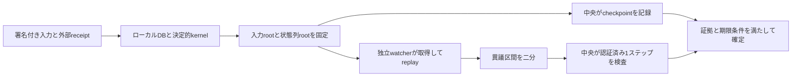

# ローカルファーストゲームの低頻度調停とLeanモデル

更新日: 2026-10-17。研究案であり、既存のwire protocolやruntimeの保証を変更しない。

## 提案する構成

ローカル操作は即時実行し、encounter / zone / matchごとの操作列を固定する。
中央は小さなcheckpointを受理し、確定済み親からの進行と証拠を確認する。
ゲーム状態の全再計算は独立したwatcherへ移し、中央が必要とする再計算を
異議のある1ステップへ限定する。これはoptimistic rollupの調停方法をゲームへ応用する案である。

ただし「誰も再計算しない」「簡単なhashだけで任意のゲーム実行の正しさを保証する」
という構成にはならない。全参加者が共謀し、正直なwatcherも実行証明もない場合は、
中央replayまたは未確定のまま保留する経路が必要になる。

ゲーム種別はまだ固定していない。最初の検討対象は、操作を即時表示でき、
資産移転・報酬・対戦結果を後から確定できるゲームとする。



## 何を保証するかを分ける

| 層 | 主張 | それだけでは分からないこと |
| --- | --- | --- |
| 署名・hash連鎖 | 誰がどのログにcommitしたか、観測済みログの差し替え | 実行がゲーム規則に従うか、未観測操作の省略 |
| PRDTの知識結合 | 認証済み証拠が順序・重複に依存せず蓄積する | 悪意ある事実の真実性、ゲーム状態の妥当性 |
| ゲームkernel | 固定した状態と入力からの次状態 | 入力が現実に起きたか、時刻や乱数が公正か |
| 確定処理 | 正当性の根拠と単一の親に拘束された結果だけを採用する | ネットワーク分断中の進行、隠し情報の秘匿 |

[PRDT論文](https://arxiv.org/html/2504.05173v3)の§2は知識lattice・guard付きaction・decisionを
分離し、§3.2.4はconsensus safetyとvalidityを別に扱う。§2.4の障害モデルは
crash、partition、message lossであり、ゲーム参加者がguardを無視する攻撃への耐性は別途必要になる。

[mizchi/prdt](https://github.com/mizchi/prdt)の`Domain`とfinalizationの分離を使う。
`resolve_batch`は固定順序で入力をvalidate/applyするため、今回のkernelの候補になる。
ただし署名されたclosureやsnapshotを得ただけで、サーバーがそのゲーム実行を軽量検証できるわけではない。
quorum方式も、単純過半数をそのままByzantine quorumとして扱わない。
固定roster、最大故障数`f`、honest signerの非二重署名の下で、交差にhonest signerを含める条件は
`2q > n + f`。既存の`n > 3f, q = n-f`を維持する。

## 操作とcheckpointのcontract案

監査対象は描画・音声・particleではなく、位置、HP、cooldown、所持品、報酬、勝敗など
ゲーム結果を決めるkernelとする。移動も勝敗へ影響するなら対象に含める。
kernelの入力には署名済みintent、入力受付receipt、論理tick、外部乱数の証拠を含める。
不正なintentに対するreject/no-opも決定的な結果として記録する。

checkpointは最低限次をcanonical encodingで束縛する。

```text
batch_id = H(domain_separator, game_id, session, scope, epoch,
             parent_checkpoint, kernel_version, rules_hash, roster_hash,
             input_count, input_root, trace_root,
             initial_state_root, final_state_root, effect_root,
             randomness_receipts_root, closure_receipts_root, deadline_policy)
```

`input_root`は順序付きの完全な入力列、`trace_root`は`state[0..N]`へcommitする。
各leafはbatchのscope/epochとindex、type tag、payload digestを束縛し、
batch digestをleafに再帰的に含めない。木の形・leaf数・padding規則も固定する。
`initial_state_root`と`final_state_root`は状態列の両端のopeningで照合する。
親は中央の確定headと一致し、同じ`(scope, epoch)`の別batchはforkとして保持する。

入力の完全性はMerkle inclusionだけでは証明できない。close前の受領証と、
参加者ごとのsequence frontier・確定した入力集合が必要になる。
受領自体が誰にも観測されなかった操作の存在は、この仕組みでは証明できない。
クライアント時計の自己申告も入力の真正性にはならない。

## 通常経路と異議経路

1. **実行と記録**: ローカルDBへ入力と状態列を保存する。peerにも配布し、ローカル表示は進める。
2. **入力集合を閉じる**: receiptとfrontierにより対象集合と順序を固定する。
   checkpointのhistory、head、outboxは既存のatomic seal contractで保存する。
3. **低頻度anchor**: 中央は署名、境界、親、kernel/version、rootの形式と端点のopeningを検査し、
   provisional checkpointを登録する。これはゲーム実行の検証済みACKではない。
   小さなscopeのrootをまとめるmacro rootで中央への送信回数を減らせる。
4. **watch**: 独立watcherは全入力と必要な親状態を取得し、同じkernelでreplayする。
   全状態列を受信しなくても、入力と親状態から参照列を計算できる。取得不能は保留する。
5. **異議**: 最終状態が違えば、固定した状態列に対し「左端が一致、右端が不一致」の区間を二分する。
   中点が一致すれば右半分、一致しなければ左半分へ進む。
   途中で再一致する履歴でも成立し、必ずしも最初の不一致を探す必要はない。
6. **1ステップ裁定**: `i`、入力`u[i]`、前後状態のopeningを元のrootへ照合し、
   中央が`step(state[i], u[i])`と`state[i+1]`を比較する。
   正しいtraceへの偽challengeは状態を変更せず拒否する。
7. **確定**: 正当性の根拠、ログ取得可能性、異議・期限の条件を満たす結果だけを確定する。
   報酬はその後に資産移転できる。親が未確定なら子もprovisionalにし、親棄却時は子を確定しない。

最終状態が一致しても途中の不正遷移が相殺される場合がある。
「最終rootが同じ」という比較だけでは、完全な履歴の妥当性を保証しない。
watcherが状態列全体の妥当性を主張する場合は、commitされた状態列の各遷移も確認する。
最終状態が同じ場合、今回の端点を使う二分探索は開始できないため、
watcherは状態列を取得して不正edgeを探し、その前後のopeningを直接提出する。
この追加の取得・走査も中央以外の費用であり、`located_step_is_fraud`の証明対象とは分ける。
外部へのeffectはすべて状態・effect rootへ含め、相殺されて見えなくならないようにする。

scopeをまたぐ資産の二重使用は、各ログが単独で正しいことだけでは防げない。
同じ資産の確定headは一つにし、移転は元scopeの確定receiptを消費してから先scopeへ反映する。
通信なしで消費を許す範囲は、事前に分配したescrow権限・予算で制限する。
未確定branchの報酬や残高を別scopeの確定資産へ取り込まない。
この資産移転の制御には既存のownership/inventory gateを使い、今回のLean証明範囲には含めない。

[OP StackのFault Dispute Game仕様](https://specs.optimism.io/fault-proof/stage-one/fault-dispute-game.html)は、
rootと実行traceを二分し、最後に1命令の状態遷移を検査する。この考え方を参照するが、
ゲーム版のタイムアウト・複数challenge・DoS対策まで実装・証明したわけではない。

## 計算量と通信頻度

マーケットでの初回入庫と通常出品、検証済み状態で履歴を切る条件、現在の検証時間は
[マーケット受理時のログ境界と計算コスト](./market-admission-cost-ja.md)を参照する。
時系列を後付けしたり結果を見てからログを選び直す探索への対策は、
[ゲームプレイの時系列固定と探索の制限](./gameplay-chronology-ja.md)で扱う。

`N`はbatch内の監査ステップ数、`C`は1ステップの実行費用、`q`は署名確認数、
`M`は認証付き状態mapの要素数、`w`は1ステップで触る要素数とする。

| 経路 | 中央のゲーム計算 | 中央の追加検証 | 中央以外の仕事 |
| --- | --- | --- | --- |
| 通常anchor | 0 | `O(q + log N)`の署名・端点opening等 | 実行・記録、watcherの`O(NC)` replay |
| 1件の異議 | `O(C)` | `O(log N)`中点query。独立Merkle pathを毎回確認する単純実装では合計`O(log² N)` hash | watcherのreplayとopening取得 |
| 全中央replay | `O(NC)` | 入力・receipt・rootの検証 | ログの提供 |
| succinct validity proof | 証明方式に依存する小さな検証 | verifierと公開入力の検証 | proverの大きな計算。今回未実装 |

この表はwatcherが参照状態列を一度replayして保存し、中点をそこから読む実装を想定する。
Leanの`run`をqueryごとに再評価する方法の総実行時間や、状態の等値比較そのものの費用を
`result.queries`が証明するわけではない。

状態全体を渡して1ステップ実行するだけでは、`C`や通信量は軽くならない。
小さく分割したkernel、またはread/write集合を認証するstate witnessが必要になる。
後者の目標費用は`O(w log M + C)`だが、未変更部分のroot保存を含む更新証明が必要で、
本LeanモデルはこのMerkle map verifierを証明していない。

二分探索を認証済みの部分木descentへ変える最適化は別課題である。
今回の`locate`の証明から「暗号検証も合計`O(log N)`」とは主張しない。
空batchは端点一致だけを確認し、二分探索は非空区間に使う。
任意長版の`locateRange`はpaddingなしで区間を二分し、返り値に中点query数を含める。
区間幅`N > 0`で端点の一致・不一致の条件を満たす場合、
不正edgeの特定とquery数`≤ ceilLog2 N`を機械検証する。
`ceil_log2_minimal`により、この深さが`N ≤ 2^d`を満たす最小の`d`であることも確認した。

中央へのanchor間隔を`B`秒、異議期間を`W`秒とすると、通常の送信頻度はscopeごとに約`1/B`。
最終確定はsealから少なくとも異議期間を待ち、未解決異議があればさらに遅れる。
`B`を長くすると接続回数は減るが、未確定資産、保存量、rollback範囲が増える。
無通信で信頼できる時間上限を与えることはできない。異議の大量発生時の中央費用も定数にはならず、
checkpoint/channelごとの件数上限、重複排除、rate limit等が別途必要になる。

## 正当性の根拠と全員共謀

確定には次のいずれかの根拠を使う。

| 根拠 | 必要な仮定 | 全参加者が共謀した場合 |
| --- | --- | --- |
| peer replay certificate | rosterの故障上限、honest signerが完全replayしてから署名、永続的な非二重署名 | rosterも全員共謀なら保証なし |
| optimistic challenge | 独立した正直なwatcher、全ログ取得、検査時間、期限内challengeの到達と裁定 | watcherが参加者とは独立なら可能 |
| succinct validity proof | 証明系のsoundnessとkernel/入力/rootの完全な束縛 | 実行整合性は検査可能。架空入力・時刻・乱数の真正性は別途必要 |
| 中央replay | 中央が完全な入力と信頼できる親状態を取得できる | 実行整合性を検査可能。外部入力の真正性は同じく別問題 |

「一定時間challengeが届かなかった」は、単独では証拠にならない。
watcherの観測・取得・処理・送信・裁定の時間を保証できない間はprovisionalを維持する。
ログ取得失敗や通信timeoutを、そのまま不正の確定判定にもしない。
retentionは`W`と通信遅延、裁定・appealの上限以上にし、未解決evidenceをpruneしない。
この境界は既存のplayer-local hold/outbox/retention contractに合わせる。

## samplingと簡単な不変条件の限界

`N`個中`b`個の不正ステップを、固定rootにcommitした後で一様独立に復元抽出する場合、
`k`回とも見逃す確率は`((N-b)/N)^k`となる。
`N=1024, b=1, k=32`では約96.92%を見逃す。
小さな抜き取りだけで、報酬を増やす1回の改竄まで強く防ぐことはできない。
commit前の抽選、seedの予測、対象集合の作り直しを許すと、この式の前提さえ失われる。
既存のdelayed seedとeligible-set sealは維持する。

通貨総量、HP範囲、速度上限などのcertificateは安価な拒否フィルタとして使える。
それらから省略したゲーム規則は検証されない。例えば通貨を保存したままteleportするログは通る。
要約`summary`だけでkernelを置き換えるなら、各入力について
`summary(step(s,u)) = abstractStep(summary(s),u)`に加えて、
確定する結果の安全性が要約上の検査から従うことをゲームごとに証明する必要がある。

## Leanで確認できる範囲

外部依存のないLean 4.34.1 / Stdモデルを[`formal/lean`](../formal/lean/README.md)に置いた。
有限個の具体例だけでなく、任意の状態型・入力型・batch長について次を証明する。

| theorem | 機械検証する主張 |
| --- | --- |
| `valid_trace_matches_run` | 全遷移が正しければ決定的replayと最終状態が一致する |
| `wrong_output_has_bad_step` | 正しい初期状態と固定入力に対する偽の出力には、不正な遷移が存在する |
| `authenticated_bad_step_refutes_trace` | 元のindex/入力/前後状態へのbindingを満たす不正遷移は、そのtraceを反証する |
| `locate_spec`, `located_step_is_fraud` | `2^d`区間の二分探索は深さ`d`で裁定可能な隣接状態を返す |
| `locate_range_spec`, `located_range_step_is_fraud` | 任意の非空区間をpaddingなしで探索し、不正edgeと`⌈log₂ N⌉`以下のquery数を返す |
| `width_fits_ceil_log2`, `ceil_log2_minimal` | 選んだ探索深さが区間を覆い、その条件を満たす最小の深さである |
| `merge_comm/assoc/idem`, `evidence_persists` | 認証済み事実のunionは半束となり、既知の不正証拠は消えない |
| `silence_not_monotone` | challenge不在は知識の増加に対して安定しない |
| `optimistic_finality_sound` | 全不正遷移が期限内challengeになるという明示的仮定と、challenge不在からtrace妥当性が従う |
| `no_unchecked_finality`, `challenged_never_finalizes`, `pending_parent_never_finalizes` | 確定gateは未検証・未監視、異議中、親未確定の結果を通さない |
| `finality_gate_sound`, `finalized_output_matches_run` | gateの各flagを対象traceの意味的証拠へ結び付ければ、受理結果の妥当性とreplayとの一致が従う |
| `run_concat`, `valid_checkpoints_compose` | 親の最終状態を使う子checkpointの検証を合成すると、連結した入力列の完全replayと一致する |
| `valid_trace_preserves_invariant`, `finalized_invariant` | kernelがゲーム固有の不変条件を保存するという証明を、確定済み結果へ引き継げる |
| `honest_quorum_intersection`, `quorum_decisions_unique` | 重複しないroster内署名者のquorumは、故障数・閾値・認証・非二重署名の仮定の下で同じ決定になる |
| `single_fraud_can_be_missed` | 復元抽出を有限回行っても、1不正の見逃し系列は残る |
| `Merkle.opening_for_vector` | context・種別・件数・indexを検査したopeningは固定した木の値と一致するか、具体的なhash入力の衝突を示す |
| `Merkle.generated_opening_accepted` | 正しい木から生成したopeningは境界条件を満たせば受理される |
| `state_commitment_prefix_ext`, `command_commitment_prefix_ext`, `empty_command_commitment` | log範囲外の値や空入力列の仮の値がrootへ影響しない |
| `verified_fraud_refutes_or_collision` | 3本のopeningを検査した不正証拠はログを反証するか、検査に関与したhash入力の衝突を示す |
| `generated_fraud_accepted`, `localized_fraud_accepted` | 不正edgeから有効な証拠を生成でき、二分探索の結果をそのまま1ステップ裁定へ接続できる |
| `valid_trace_rejects_without_collision` | 関与するhash入力に衝突がなければ、正当なログへの偽告発は拒否される |
| `accepted_fraud_hash_budget` | 受理された証拠のopening入力数は`2 ceilLog2(N+1) + ceilLog2(N) + 6`となる |

`Tests.lean`は正常例に加え、報酬改竄、teleport、再一致するtrace、sampling見逃し、
未検証timeout、入力差し替え、偽の親状態、単純過半数の不十分さの具体例を固定する。
kernelの残高上限を確定結果へ引き継ぐ例も含む。`sorry`による警告はbuild失敗になり、
未宣言変数の暗黙導入も禁止する。
samplingの定理は見逃し系列の数の式と正の値を証明し、確率空間の構成までは行っていない。

### openingの仮定から検証関数へ

`Merkle.lean`はleaf、node、metadata付きrootのpreimageを別の型constructorで表す。
metadataには外部から固定したcontext、状態列/入力列の種別、件数を含める。
実際のcontextにはsession、scope、epoch、kernel versionなど、checkpointの信頼境界を含める必要がある。
proofは深さ付きのroot→leaf pathで、`verifyOpening`はindex、件数、最小深さ、rootを照合する。

有限長digestの全域的な単射性は仮定しない。偽openingが受理された場合は、
openingとcommit済み木の構築に使ったpreimageの列から、異なる入力が同じhashになった組を示す。
このため「衝突が存在しない」という仮定で最初から矛盾させる証明にはしていない。
`collision_splits_encoding`は曖昧なencodingとbyte hashの衝突を分け、
`encoded_collision`は関与するpreimageのencodingが一意ならbyte hashの衝突になることを示す。
canonical encoderの一意性やSHA-256の安全性自体は未証明である。

`Fraud.lean`は状態列の長さを`N+1`、入力列を`N`として別々にcommitする。
実データには状態/入力のtagを付け、範囲外は専用の`none` leafへ固定する。
テストで「空ログや3件の入力のrootが範囲外の値に依存する」反例を先に再現し、
専用paddingに修正した上でprefixへの依存だけを証明した。
`verifyFraud`は前状態・後状態・入力の3本のopeningとindex範囲を確認し、
1回のkernel適用結果と後状態を比較する。偽の最終状態から証拠を生成・受理する経路と、
衝突がないとき正当なログを告発できないことを、それぞれ証明する。

このモデルは最小深さの完全二分木と専用paddingを使う研究用表現である。
既存MoonBitの奇数末尾複製、leaf→root path、文字列encodingとは一致しない。
wire formatの変更ではなく、これらの対応、raw pathのdecode、byte/proof budgetの実装検査は残課題である。
hash入力数の定理も、衝突証拠の構築費用、実際のhash実行時間、通信量を証明するものではない。

hashのcollision resistance、署名、ログavailability、watcherの存在・期限内到達、
kernel実装とのrefinement、完全なBFT protocol、succinct proof verifierは未証明である。
`optimistic_finality_sound`がwatcherの仮定自体を証明したと解釈してはならない。
`locate`と`locateRange`は状態の等値比較を使う数学的モデルであり、ネットワーク上のMerkle dispute実装ではない。
新しい`verifyFraud`も研究モデル内の検証関数であり、MoonBit verifierとのrefinementは未実施である。
`FinalityEvidence`は「検証済みflagを渡した」という理由だけでは構築できず、
対象traceに対する証明または明示的な環境仮定が必要になる。
quorumの定理も静的な投票instanceの一致までで、roster更新、鍵の永続化、
view change、再起動時の非二重署名、protocol全体の安全性・進行性は別課題である。

次の実装では、既存`audit/merkle`と汎用の認証境界へindex付きopeningを接続し、
実験用のbounded game kernelでこのLeanの反例をMoonBitへreplayする。
その後、Quintへdispute/withholding/deadline/parent rejectionの状態機械を追加し、
正常・破損modelで照合する。ゲーム固有の規則は`src/x/game_audit`に置く。

```sh
just prove-lean
```
