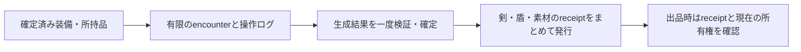

# マーケット受理時のログ境界と計算コスト

更新日: 2026-10-17。設計提案とローカル計測を分けて記す。
既存protocol、runtime、Leanの保証範囲は変更しない。

## 持ち歩く範囲は最後の「検証済み状態」から

出品のたびにユーザーの全プレイ履歴を検査しない。アイテム生成の正当性を一度検査し、
以後はその結果を保証するreceiptと、現在の所有権・versionを使う。
履歴をたどる終端は「直近の時刻」「サーバーにrootを送った時点」ではなく、
対象の規則・状態・外部依存まで検証して受理したcheckpointである。
rootの保存や署名だけでは、そのゲーム実行を検証済みにはできない。

| 受理する状況 | クライアントが提示するもの | 新たに検査する生ログ |
| --- | --- | --- |
| 市場がすでに現在の所有権を保存している | asset ID、期待version、署名付き売却要求 | 0件。現在のDB状態を照合する |
| 生成と所有権が確定した別scopeからの入庫 | 信頼済み確定checkpointの証明書、item record、所属証明、移出を確定したreceipt | ゲームログ0件。移出元で同じ資産を使えないことも確認する |
| 既知anchor以降の未受理移転がある | anchorと、そこから現在recordまでの全移転証拠 | 未受理分の移転だけ。上限超過時は非同期検証へ送る |
| 未確定の戦利品を初めて入庫する | 信頼済み開始状態、取得までの入力、外部receipt、生成結果 | 生成に必要な未検証の依存範囲すべて |
| 未確定素材から作ったアイテムを入庫する | 素材の確定receiptと消費・生成証拠 | 素材が未確定なら取得元まで検証を広げるか保留する |

確定証明書の信頼根拠は、中央replay、固定rosterの故障上限を満たすreplay certificate、
データ取得と正直なwatcherを保証したoptimistic確定、soundな実行証明のいずれかである。
クライアントが選んだ署名者や自己申告の「最新checkpoint」は信頼境界に使わない。
証明書の同一statementの暗号検査はcacheできるが、失効・保留・現在versionは受理時に確認する。

これは[OP Stackのanchor state](https://specs.optimism.io/fault-proof/stage-one/fault-dispute-game.html#anchor-state)
が既知の正しい状態から主張された状態までを対象とし、新しいanchorで必要な履歴を縮める考え方を、
ゲームの資産受理へ適用する提案である。

## 未検証の依存を飛ばさない

例えば「ボスを倒して剣を得た」の確認には、最後のdrop eventだけでは足りない。
開始時の装備・能力、ボス状態、味方の攻撃、乱数、持ち込んだ消耗品などが結果へ影響するなら、
それらを確定済み入力へ結び付けるか、対応する未検証ログも確認する。
ユーザー本人の操作だけでは、協力プレイの結果を保証できない。

安全に履歴を省略する条件は、結果へ影響するすべての依存経路が、
検証済み状態または検証済み外部receiptに到達することである。
位置・HP・装備等の要約だけで省略する場合も、省略した規則が受理結果に影響しない証明が必要になる。
関連eventだけを抜き出して、入力の完全性や順序の確認を省くことはできない。

無制限のopen worldでは、この範囲が過去全体へ広がる可能性がある。
実用上は、確定済み装備・所持品を入力とする有限のencounterを作り、
encounter外の影響は認証済みreceiptだけで取り込む。
報酬の二重請求を防ぐため、開始ticket・入力状態のversion・出力index・消費を束縛する。
時刻や乱数が報酬条件なら、その真正性も必要であり、クライアントの自己申告を根拠にしない。



1 encounterで12個のitemが生成されるなら、戦闘の検証を1回で共有し、
各itemはeffect rootへの所属証明で結果を参照する。
itemを売るたびにその戦闘を再実行する必要はない。
取引は`asset_id / owner / version / status`を原子的に確認し、
出品中のlockまたはescrowへ移す。同じ古い所属証明を二度提示しても二重売却できないようにする。
中央の毎tickのsimulationを省いても、この資産消費の直列化は必要になる。

## 現在の実装の計測

2026-10-17、Apple M5、Node v24.21.0、release生成JS、warmup後10反復で
[`bench-lineage.ts`](../examples/cf-game-audit/scripts/bench-lineage.ts)を実行した。
[`結果JSON`](../examples/cf-game-audit/benchmarks/lineage-local-2026-10-17.json)を保存している。
これは小さな固定fixtureによる比較であり、本番の処理能力や長いゲームログのreplay性能ではない。

| 未受理の移転数 | bundle bytes | MoonBit検証平均 | 標準暗号等の追加検証平均 | 直列2段階の平均合計 |
| ---: | ---: | ---: | ---: | ---: |
| 1 | 4,313 | 24.982 ms | 0.554 ms | 25.536 ms |
| 8 | 12,727 | 83.828 ms | 1.004 ms | 84.832 ms |
| 32 | 41,670 | 281.566 ms | 2.508 ms | 284.074 ms |
| 64 | 80,326 | 563.795 ms | 4.558 ms | 568.353 ms |

MoonBit段階には現在のexperimental暗号による検査があり、その後に標準WebCryptoによる
独立検証も実行している。4.558 msを検証全体の時間として扱えない。
標準backend中心に構成し直す余地はあるが、その移行後の全体時間はまだ測っていない。
合計列は2段階の平均値の和であり、percentileを足した値ではない。
fixture生成、ゲームreplay、ネットワーク、DB処理はこの検証時間に含めない。
fixture生成時間は結果JSONの別列にある。

再実行:

```sh
moon build --target js --release
AUDIT_LINEAGE_BENCH_ITERATIONS=10 pnpm --dir examples/cf-game-audit exec tsx scripts/bench-lineage.ts
```

既存の[Cloudflare評価](./cloudflare-game-audit-ja.md)では、過去のlocal workerd小標本として、
1 assetのcheckpoint投入が3,266 bytes / E2E平均21.333 ms、
保存済みcurrent-ownerへの出品照会が平均2.931 msだった。
今回のNode計測と経路・日時・標本数が違い、いずれもremote RTTや本番負荷を示さない。
それでも、保存済みの所有権を使う経路と、移転履歴を再検査する経路の費用差は設計上重要になる。

## ログ量と費用の予算

以下は計測ではなく仮定による算術例である。
1人あたり毎秒10入力、payload 96 bytes、入力ごとに署名64 bytesとすると、
2分間は1,200入力、署名込み192,000 bytesになる。
8人なら9,600入力、1,536,000 bytesであり、NPC状態・外部receipt・header等はさらに加わる。
8時間では1人でも46,080,000 bytesとなるため、出品ごとの全履歴送信には向かない。
入力のbatch認証は容量を減らせるが、入力集合・順序の真正性を保つcontractが必要になる。

通常受理の目標費用は、少数の署名検査、item所属証明、DBでの原子的な所有権更新である。
要素数`M`に対する平衡Merkle木なら所属証明は`O(log M)`。
理想的な32-byte siblingだけなら100万leaf・深さ20で640 bytesだが、
実装のauthmapはtreapで、pathにkey/value等も含む。640 bytesを現在のwireサイズとはみなさない。
新しいログを直接replayして確定する費用は、対象入力数`E`、kernel単価`C`に対して`O(EC)`となる。

二分探索は異議のある遷移を裁定者が特定する費用を減らす。
初めて見た任意のログの正当性を、全体で`O(log E)`の処理だけで確認するものではない。
optimistic方式ではwatcherがreplayとデータ取得の費用を負い、
中央replay方式では入庫時に中央が負う。中央負荷をwatcherへ移すことと、総計算量の削減は区別する。

初期の運用案は、通常出品を生ログ0件とし、未受理の移転は最大8件を同期検証の候補にする。
今回の8件でも検証平均は約85 msであり、8件は確定した性能要件ではない。
本番環境の予算に合わせ、件数・bytes・処理時間のいずれかを超えたら受理を保留して背景検証する。
ゲームログの初回入庫もencounter単位で背景検証し、同じ結果の複数itemへ費用を分散する。
上限超過時に古い未検証ログを捨て、残りだけで受理してはならない。
既存のslice最大64件・資産あたり保存256件は安全上限であり、日常経路の目標値にはしない。

## 持ち歩かないことと削除できることは違う

| 保管者 | 維持する情報 | 省略・削除の境界 |
| --- | --- | --- |
| プレイヤー | 未確定ログ、最新receipt、必要なopening、保存先参照 | 確定後は次回受理に生ログを添付しない。保存義務は別途満たす |
| 市場 | asset head、生成receipt、受理済みanchor、消費・保留・失効状態、決定記録 | 市場が資産を扱う間、現在状態と再利用防止情報を維持する |
| watcher / object storage | raw input、必要状態、異議・appeal用証拠 | 異議期間・取得猶予・裁定・appealをすべて終え、未解決案件がないときだけ削除を検討する |

hashと保存先URLだけではデータ取得可能性を保証しない。
必要なログが取れなければ、optimisticな受理の前提を満たさず保留となる。
容量上限へ達しただけで安全にpruneできるわけでもない。

過去の生成不正をいつまでも遡及して失効させたい場合は、
生成・移転・craftingを結ぶ由来indexと、判定に必要な証拠も維持する。
rootだけから依存する子孫itemを列挙することはできない。
固定の最終確定・appeal期限後にraw logを捨てる運用は、期限後の再検証範囲を制限するというpolicy選択になる。

## Leanとの接続

既存の`valid_checkpoints_compose`は、正しい親の最終状態を入力とする正しい子を連結すると、
完全replayと一致することを示す。これは検証済みprefixを再実行しない根拠の一部になる。
ただし、署名付きreceiptの実装がその妥当性を保証すること、
省略した依存が結果へ影響しないこと、itemの消費が一意であること、
retention中に証拠が取得可能であることは、この定理だけでは証明されない。
次の形式化対象は、任意の履歴短縮ではなく、受理済み状態を境界とする依存の切断と資産の一意消費である。
