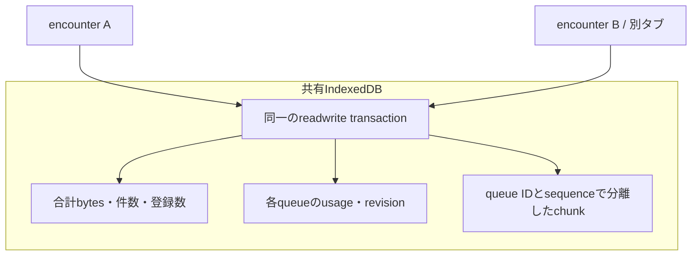

# 複数encounterの生ログを共有予算で保持する

更新日: 2026-10-18。
[`IndexedDbAuditPayloadPool`](../examples/cf-game-audit/web/src/audit/payload-pool.ts)を追加し、
[`EncounterRecorder`](../examples/cf-game-audit/web/src/audit/encounter-recorder.ts)の保存先を切り替えた。
同じIndexedDBの中で全queueの合計容量・件数・登録数を管理する。
旧ブラウザ画面のsnapshot保存先や、authority側の台帳容量はこの予算に含めない。

## 容量と処理

encounter用の既定値は次のとおり。

| 対象 | 上限 |
| --- | ---: |
| 共有の論理byte予算 | 1 MiB |
| payloadに使わせないheadroom | 128 KiB |
| 全queueのpayload合計 | 896 KiB |
| 全queueのchunk合計 | 256件 |
| 登録queue数。空のqueueも含む | 128件 |
| 1 queueのpayload | 8 KiB、2件まで |
| 1 chunk | 4 KiB |

1 queueだけが収まっていても、全体上限に達すれば`backpressure`を返す。
新しいqueueを登録できない場合は、記録を始める前にcapacity errorを返す。
[開始前予約](./encounter-http-and-reservation-ja.md)を使う新規開始では、さらにログ全体の8 KiB・2件を確保してからticketを要求する。
記録済みと予約済みの合計を全体上限に収め、予約の再送・pruneで使用回数を戻さない。
容量を空けるために未確定ログ・保留中のログを自動削除しない。
小さなログや空のqueueを増やす場合も、件数・登録数によって管理情報の増加を抑える。



appendは既存MoonBit gateを、対象queueと全体予算の両方へ適用する。
chunk追加と両方のusage更新を一つのtransactionでcommitし、quota errorではすべてrollbackする。
別タブも同じobject storeを更新するので、残り容量を二重に消費しない。
通常appendのDB操作数はqueue数・過去ログ数に依存しない。
読み出し・prefix削除は一度に最大64件。待機中のpayloadコピーはconnectionごとに最大4件に制限する。
全タブの合計RAMをこの値だけで制限するものではない。

起動時は保存済みcounterを信用して初期化し直さず、全queueのusageとretained chunkを照合する。
走査はstreamingで、費用は`O(queue数 + chunk数 + payload量)`。
application sessionで一つのpool connectionを共有し、encounterを開くたびの全体走査を避けられる。
予算の変更やcounter不整合を検出した場合は、既存データを残してopenを拒否する。

headroomは論理payload予算の中の余裕である。browserの物理disk空きやcontrol領域を予約するAPIではない。
index・engine overhead・一時領域・他のIndexedDBは計上せず、物理使用量が1 MiB以下になるという保証ではない。

## 登録枠の解放と古い操作

`prune(grant)`は認証された連続prefixの生ログだけを消す。
queueのwatermarkは残るので、管理情報の登録枠を返すには`release(grant)`を別途呼ぶ。
releaseには、全chunkの削除済み状態と、保持終了を認証する許可が必要になる。
一度もchunkを書いていない予約だけは、`releaseEmpty()`で解放できる。
一度書いた後で空になったqueueへ、この例外は適用しない。

全体revisionは登録・追加・削除・解放ごとに増え、作成したqueueへ新しいincarnationを割り当てる。
queue自身のrevisionは、そのqueueが変わったときだけ更新する。
したがって、別queueの追加は既存grantを無効にせず、対象queueの追加はgrantを古くする。
登録枠を解放して同じIDを作り直しても、古いハンドルはincarnationが一致せず、
以前のqueue revisionを束縛したgrantは新しいrevisionと一致しない。
revisionが`Number.MAX_SAFE_INTEGER`へ到達した場合は変更を拒否し、巻き戻さない。

この機構を使っても、新しいゲームプレイには新しい認証済み開始権を使う。queue IDはその開始権とunitから導出する。
削除許可は対象prefix全体の不可逆な保持終了を認証するものであり、単なるACKではない。
署名とretentionの意味は[encounterのauthority contract](./encounter-lifecycle-ja.md)が担当する。

## 接続

`EncounterRecorder.open`は既定で`converge-audit-encounter-payloads-v2`へ保存する。
DB名をticketごとに変えると予算が分かれるため、共有applicationのDB名として扱う。
複数recorderへ同じ`payloadPool`を渡せば、一つのconnectionを使い回せる。

```ts
const pool = await IndexedDbAuditPayloadPool.open({
  factory: indexedDB,
  name: ENCOUNTER_POOL_NAME,
  limits: ENCOUNTER_POOL_LIMITS,
  maxQueues: ENCOUNTER_POOL_MAX_QUEUES,
});
const recorder = await EncounterRecorder.open({
  factory: indexedDB, payloadPool: pool,
  ticket, trustedAuthorityKey, owner, cryptoBackend, transport,
});
// 記録・commit・settleを経て、authorityの保持期限と全holdが閉じた後:
if (await recorder.prune() === "pruned") await recorder.release();
recorder.close(); // 注入したpoolは閉じない
pool.close();
```

削除後のレシート再取得は`EncounterRecorder.recoverReceipt(...)`で行う。
これは署名・ticket束縛を検証するが、queue登録やpayload保存を行わない。
生ログ保存枠が満杯でも、すでに確定したアイテムのレシートを取得するための枠を要求しない。

旧単独queue DBとのschemaは異なる。旧名をそのまま使った場合はopenを拒否し、保存済みログを消さない。
旧DBからの自動移行は未実装で、旧画面のsnapshot / event logも別途移行する必要がある。
`name`を独自指定するhostは、encounter間で同じ名前と設定を維持する責務を持つ。

## 実測と検証

[Chromium実測artifact](../examples/cf-game-audit/benchmarks/payload-pool-chromium-2026-10-17.json):
Chromium 151、darwin arm64、warmup 8 queue、測定64 queue。
128 chunk・計512 KiBを保存して再openし、その後すべてprune・releaseした。

| 処理 | p50 | p95 |
| --- | ---: | ---: |
| queue登録 | 0.2 ms | 0.3 ms |
| 4 KiB append | 0.2 ms | 0.3 ms |
| 8 KiB prefix削除 | 0.3 ms | 0.9 ms |
| 空の管理情報の解放 | 0.2 ms | 0.4 ms |

512 KiB / 128 chunk / 64 queueの再open・全件照合は1回測定で4.0 ms。
moduleは読み込み済みであり、初回のapplication起動時間ではない。
Playwrightの一時browser contextでの測定で、network・署名検証・ゲームreplayを含めず、物理diskのfsync性能も測定しない。
artifactのuser agentはDesktop Chromeのemulation値なので、実hostは別の`host`欄に記録する。

Node/fake-indexeddbの17テストで、共有容量、各queueの上限、別connectionの競合、
登録数上限、解放・同じIDの再作成、古いgrant、遅延認証、quota rollback、旧DB保護、counter不整合を確認する。
既存の実暗号encounterテストもpoolへ切り替え、異なる2 ticketの予算共有と、枠を使わないレシート復旧を確認した。
Playwrightでは2タブ・リロード・容量回復を確認し、encounter経路では引き続き実署名で許可を検証する。

[`PayloadPool.lean`](../formal/lean/ConvergeAudit/PayloadPool.lean)は15定理・18例で、
合計・個別予算の維持、安全なprefix削除後の合計予算、登録数の上限、解放の空条件と認証条件、
revision/incarnationによる古いgrantの拒否条件を検査する。
MoonBitではscope登録guardと4補題を追加し、全体と個別のbyte/countには既存guardを再利用する。
数学モデルからIndexedDBへの完全なrefinement proofや、署名・engineの正しさを証明したものではない。
既存Quint protocolは回帰検査するが、このpool専用のQuintモデルは追加していない。

```sh
just test-payload-pool
just bench-payload-pool
just prove-lean
just prove
just formal-check
pnpm --dir examples/cf-game-audit typecheck
```

## 残る接続

公開Worker APIと開始前予約は[接続済み](./encounter-http-and-reservation-ja.md)。
[既定画面との配線](./encounter-ui-ja.md)も完了し、control JSONを80 KiB・最大16戦分へ制限した。
確定済みreplay資料の[archive移管](./encounter-archive-ja.md)も接続済み。
旧保存形式の移行、レシート圧縮、全originを合計した保存予算は残る。
このpoolが制限するのは、同じDBへ入るencounter生ログとその管理情報である。
`EncounterRecorder.start`では全ログを予約する。復旧用の`open`には新規予約を強制しない。
[未成立・中断ticketの認証済み解放](./encounter-termination-ja.md)も接続済み。予約してもbrowser quotaや通信期限による失敗はあり得る。
保留が長引けば有限容量は満杯になる。停止せず進めるには、archiveへの認証済み保管責任移転が別途必要である。
